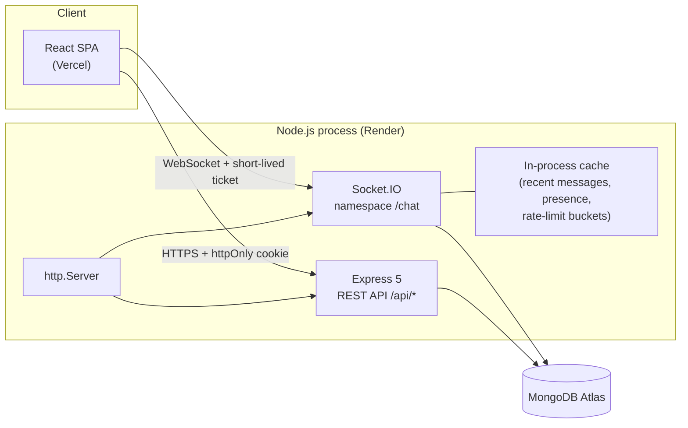
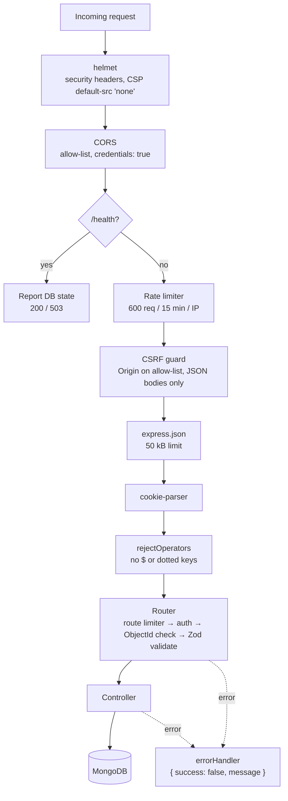
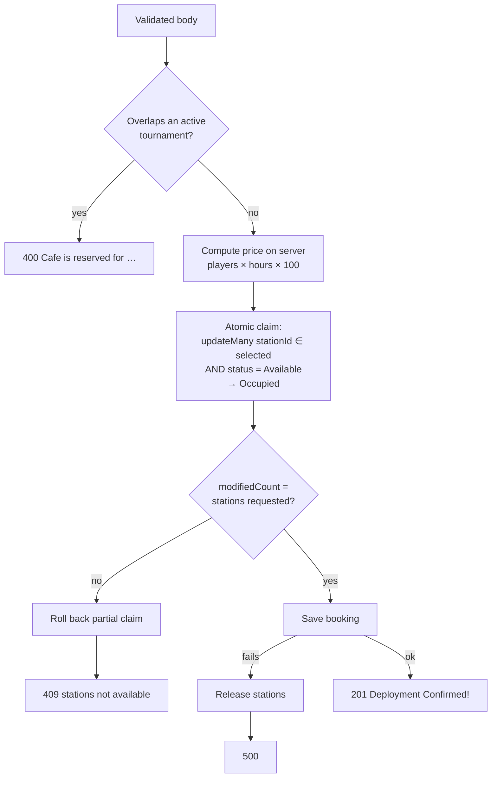
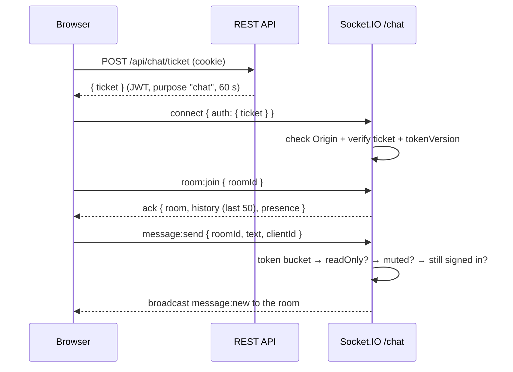

# Nexus — Gaming Café Management Platform (Backend API)


Nexus runs a gaming café. Players book PC and console stations, sign up teams for tournaments, message the café and talk to each other in a live chat. Admins see the whole floor from one dashboard. They free up hardware, approve or reject teams and manage the inbox.

This repository is the **backend**: a TypeScript REST API and a real-time Socket.IO server, both running on Express 5 and MongoDB.

**Live app:** [nexus-frontend-lyart.vercel.app](https://nexus-frontend-lyart.vercel.app/)
**Frontend repository:** [Jatinyadav29/nexus-frontend](https://github.com/Jatinyadav29/nexus-frontend)

> **Status:** the API is moving to a new Render service. Until that deploy is finished, the live frontend loads but calls to the API may fail.

---

## Table of contents

- [My role](#my-role)
- [Feature overview](#feature-overview)
- [Architecture](#architecture)
- [The request pipeline](#the-request-pipeline)
- [Authentication and sessions](#authentication-and-sessions)
- [Core processes](#core-processes)
  - [Station booking](#1-station-booking)
  - [Tournament registration](#2-tournament-registration)
  - [Admin control](#3-admin-control)
  - [Contact inbox](#4-contact-inbox)
  - [Live chat](#5-live-chat-real-time)
- [Security](#security)
- [Data model](#data-model)
- [API reference](#api-reference)
- [Project structure](#project-structure)
- [Getting started](#getting-started)
- [Environment variables](#environment-variables)
- [Testing](#testing)
- [CI/CD and deployment](#cicd-and-deployment)
- [Known limitations and roadmap](#known-limitations-and-roadmap)
- [Documentation](#documentation)

---

## My role

I built the **backend**: the API design, the database schemas, authentication, the business rules for bookings and tournaments, the real-time chat server, the security hardening, the test suite and the deployment setup. The React frontend talks to this API through one typed client.

---

## Feature overview

| Area | What the backend does |
|---|---|
| **Accounts** | Registration and login with bcrypt-hashed passwords. The session is a JWT in an httpOnly cookie. User and Admin roles. Logout signs the user out on every device. |
| **Station booking** | Books one or more PC/console stations. Stations are claimed atomically, so two players can't take the same one. The price is calculated on the server, and bookings that overlap a tournament are refused. |
| **Tournaments** | Admins create, edit and delete tournaments. Players register teams of 5–6. Capacity, duplicate and closed-tournament checks run inside a single atomic database update. Admins approve or reject teams. |
| **Admin dashboard** | One call returns every station's state, all active bookings and the player count. Admins can force-cancel a booking (which frees its stations) and set a station to Available, Occupied, Maintenance or Offline. |
| **Contact inbox** | A public contact form with its own rate limit. Admins can list messages, mark them read and delete them. |
| **Live chat** | Socket.IO chat with a lobby, a room per tournament and an admin-only announcements room. Includes history, presence, typing indicators, flood control, duplicate-safe resends, message deletion and admin mutes. |
| **Operations** | Environment checked at boot, health endpoints, graceful shutdown, a single error format, and CI that type-checks, tests and builds. |

---

## Architecture



- **One process, one port.** Express and Socket.IO share one `http.Server` (`src/server.ts`). `src/app.ts` builds the Express app without starting it, so the tests can import it directly.
- **Layers:** `routes/` (paths, middleware, validation) → `controllers/` (business rules) → `models/` (Mongoose schemas). Chat logic that both REST and sockets use is in `services/chat.service.ts`.
- **Types throughout:** strict TypeScript with `noUncheckedIndexedAccess` and no `any`. Request body types are generated from the Zod schemas (`z.infer`), so a body's validation and its type can't drift apart.
- **Startup order:** validate the environment → connect to MongoDB → start listening. If the database can't be reached, the process exits instead of accepting requests that would only time out.
- **Graceful shutdown:** on `SIGTERM` (Render sends one on every deploy), the server disconnects chat sockets, lets in-flight requests finish, closes the database connection and exits. After 10 seconds it forces the exit.

---

## The request pipeline

Every `/api` request passes through these steps in order (`src/app.ts`):



Every response uses the same envelope:

```json
{ "success": true, "message": "optional", "...payload": "..." }
```

Errors have the same shape, with a fixed, safe message. Clients never receive a stack trace, a database driver error or a parser message.

| Status | Meaning |
|---|---|
| 400 | Validation failed, malformed id, malformed JSON, or an operator key in the body |
| 401 | Not signed in, or the token is invalid, expired or revoked |
| 403 | Not an admin, not the owner, or the Origin isn't allowed |
| 404 | Not found |
| 409 | Station conflict (already taken) |
| 413 | Body larger than 50 kB |
| 415 | Body isn't JSON |
| 422 | Username already taken |
| 429 | Rate limit exceeded |
| 500 | Unexpected error (details go to the server log only) |

---

## Authentication and sessions

Authentication is built in-house, without Passport or third-party auth providers.

```mermaid
sequenceDiagram
    participant B as Browser
    participant API as Nexus API
    participant DB as MongoDB

    B->>API: POST /api/users/login { email, password }
    API->>DB: find user (+password)
    API->>API: bcrypt.compare
    API->>API: sign JWT { userId, tv: tokenVersion } HS256, 7 days
    API-->>B: Set-Cookie: token=…; HttpOnly; Secure; SameSite
    Note over B: JavaScript can't read the cookie

    B->>API: GET /api/users/profile (cookie sent automatically)
    API->>API: verify signature + algorithm
    API->>DB: load user, compare tv with tokenVersion
    API-->>B: 200 { user }

    B->>API: POST /api/users/logout
    API->>DB: tokenVersion += 1
    API-->>B: expired cookie
    Note over API: every older token is now rejected on every device
```

**How it works:**

- **Password storage:** a Mongoose `pre("save")` hook hashes passwords with bcrypt (cost 10). The `password` field is `select: false`, so it is never returned unless a query asks for it.
- **Token:** a JWT signed with `JWT_SECRET` (at least 32 characters, checked at boot). Verification accepts **only HS256**, which blocks algorithm-confusion attacks.
- **Cookie:** `httpOnly`, `Path=/`, and `Max-Age` equal to the JWT lifetime. In production it is `Secure; SameSite=None`, because the frontend and API are on different sites. `COOKIE_SAMESITE` can change this (for example to `lax` once the API is served from the same origin). Locally it is `SameSite=Lax`.
- **Revocation:** every token stores the user's `tokenVersion` as `tv`. Logout increments that number, so every token issued before it stops working on all devices. A JWT on its own can't be revoked this way.
- **Middleware** (`src/middleware.ts`):
  - `isLoggedIn` requires a valid cookie and attaches `req.user`.
  - `optionalAuth` is for public routes whose response depends on who is asking (for example, admins see full tournament rosters). It never rejects a request.
  - `isAdmin` checks the role on the server. The frontend's route guard is only for convenience.

---

## Core processes

### 1. Station booking

`POST /api/bookings` — `src/controllers/booking.ts`



- **No double booking:** the station claim is one `updateMany` that only matches stations that exist **and** are still `Available`. If two requests race for the same station, only one claim modifies it. The other sees a short `modifiedCount`, releases whatever it did claim and returns **409**.
- **Rollback:** if the booking fails to save after the stations were claimed, the stations are released, so a failed request never leaves hardware locked.
- **Tamper-proof pricing:** any `totalAmount` sent by the client is ignored. The server calculates `membersCount × hours × 100`. When a booking's time changes, the price is recalculated.
- **Tournament blackout:** a booking (or a new time for one) that overlaps an `Upcoming`, `Registration Open` or `Live` tournament is refused.
- **Ownership:** customers only ever see their own bookings. Admins see all of them. Viewing, editing or cancelling a booking goes through one `isOwnerOrAdmin` rule.
- **Cancelling** a booking frees its stations.

### 2. Tournament registration

`POST /api/tournaments/:tournamentId/register` — `src/controllers/tournament.ts`

All the registration rules run inside **one atomic `findOneAndUpdate`**, so two teams registering at the same moment can't overfill the tournament or claim the same name:

```js
Tournament.findOneAndUpdate(
  {
    _id: tournamentId,
    status: { $nin: ["Completed", "Cancelled"] },          // still open
    "registeredTeams.captain":  { $ne: userId },           // one team per captain
    "registeredTeams.teamName": { $ne: teamName },         // unique team name
    $expr: { $lt: [{ $size: "$registeredTeams" }, "$maxTeams"] }, // not full
  },
  { $push: { registeredTeams: { teamName, captain: userId, players } } },
)
```

If nothing matches, the backend re-reads the tournament to find the exact reason ("Registration is closed", "Tournament is full", "already registered") and returns it.

- Teams must have **5 or 6 players**, each with a name, in-game ID and phone number. Both Zod and the Mongoose schema check this.
- New teams start as `Pending`. An admin **approves** one (its status is updated) or **rejects** it (it is removed from the roster).
- **Rosters are private:** the public `GET /tournaments` endpoints return only `{ _id, teamName, status }` for each team. Admins (recognised through `optionalAuth`) get the full roster with player phone numbers.
- Creating or deleting a tournament also updates the chat room list, so every tournament gets its own room.

### 3. Admin control

`src/controllers/admin.ts`

- **`GET /admin/dashboard`** runs three queries in parallel (`Promise.all`): every station, the active bookings with their users, and the player count. The admin dashboard is built from this one response.
- **`PUT /admin/booking/:id/cancel`** marks the booking `Cancelled` and frees its stations right away. Bookings that are already cancelled or completed are refused.
- **`PUT /admin/station/:id`** sets a station to `Available`, `Occupied`, `Maintenance` or `Offline`. Any other value is refused by validation.

### 4. Contact inbox

- `POST /messages` is public, so it has its own rate limit (10 per hour per IP). It validates name, email, subject and message length.
- Admins list messages, mark them `Read` and delete them.

### 5. Live chat (real time)

`src/realtime/`, `src/services/chat.service.ts`, `src/controllers/chat.ts`

The frontend and API are on different sites, and a Vercel rewrite can't proxy WebSockets, so the session cookie can't be relied on during the socket handshake. The chat uses a **ticket** exchange instead:



- **Separate tokens:** a chat ticket has `purpose: "chat"` and lasts 60 seconds. A session token is refused as a ticket and a ticket is refused as a session cookie, so one can't be swapped for the other.
- **Handshake checks:** browsers don't apply CORS to WebSocket upgrades, so the handshake checks `Origin` against the same allow-list as the REST API. This blocks cross-site WebSocket hijacking. The default namespace refuses every connection.
- **Rooms:** a lobby, one room per tournament and a read-only announcements room where only admins can post. Rooms are created the first time they are listed.
- **Checks on every message:** the payload is validated with Zod, the user must have joined the room, a per-user **token bucket** limits the sending rate, the room must not be read-only, and the user must not be **muted**. The backend also re-reads the user's `tokenVersion`, so logging out elsewhere or being muted takes effect on the very next message.
- **Idempotent resends:** each message carries a client-generated `clientId`, and a unique `{ user, clientId }` index means a resend after a reconnect is never stored twice.
- **Presence and typing:** presence broadcasts are debounced (1 second per room) and typing events are throttled (once every 2 seconds per user per room), which keeps traffic down in busy rooms.
- **Moderation:** authors can delete their own messages within 5 minutes, and admins can delete any message. Admins can mute a user for 0–10,080 minutes (up to 7 days). Logging out disconnects all of that user's sockets.
- **Caching:** the last 50 messages of each room and the room list (5-minute lifetime) are kept in memory. A version counter stops a slow database read from overwriting newer data in the cache. History older than that is paged from MongoDB using the `{ room, _id }` index.
- **Frame limit:** socket frames are capped at 4 kB. The largest valid message is 500 characters.

---

## Security

The security work was done finding by finding. Each item has an id in [`docs/AUDIT.md`](docs/AUDIT.md) and a test that proves the fix.

| Threat | Defence |
|---|---|
| NoSQL injection | `rejectOperators` refuses any body key that starts with `$` or contains `.`. Mongoose `sanitizeFilter` wraps user values in `$eq`, and only operators written in our own code are marked `mongoose.trusted()`. Zod validates every route input. |
| CSRF | On POST/PUT/DELETE, a present `Origin` must be on the allow-list, and bodies must be `application/json`, which an HTML form can't send without a CORS preflight. |
| Brute force and spam | Per-IP rate limits: 600 requests per 15 min on the whole API; **10 failed logins** per 15 min (successful logins don't count); 10 sign-ups per hour; 10 contact messages per hour; 60 chat tickets per 15 min. |
| Session theft or reuse | httpOnly, Secure, SameSite cookie; HS256-only verification; `tokenVersion` revocation. |
| Mass assignment and price tampering | Zod drops unknown fields, and the price is always calculated on the server. |
| Data exposure | Passwords, `tokenVersion` and `chatMutedUntil` are `select: false`. Public station and tournament responses are trimmed. Error messages are fixed text. |
| Oversized or malformed input | 50 kB JSON limit, 4 kB socket frames, ObjectId checks on every id parameter, length limits on every string. |
| Weak configuration | The Zod schema for the environment refuses to boot with a missing or weak secret, and its messages name variables, never values. |
| Headers | `helmet` with a deny-all CSP (this is a JSON-only API), and no `X-Powered-By`. |
| Clickjacking and framing | `frame-ancestors 'none'`. |

---

## Data model

```mermaid
erDiagram
    USER ||--o{ BOOKING : places
    USER ||--o{ TEAM : captains
    TOURNAMENT ||--o{ TEAM : "registeredTeams (embedded)"
    TEAM ||--|{ PLAYER : "players (embedded, 5-6)"
    STATION }o--o| BOOKING : activeBooking
    STATION }o--o| USER : assignedUser
    CHATROOM ||--o{ CHATMESSAGE : contains
    USER ||--o{ CHATMESSAGE : writes
    TOURNAMENT ||--o| CHATROOM : "has a room"

    USER { string email UK; string username UK; string password "bcrypt, hidden"; enum role "User|Admin"; number tokenVersion "hidden"; date chatMutedUntil "hidden" }
    STATION { string stationId UK "PC-01, C-05"; enum type "PC|Console"; enum status "Available|Occupied|Maintenance|Offline" }
    BOOKING { ObjectId user; string[] stations; enum bookingType; number membersCount; date start; date end; number totalAmount "server-computed"; enum status "Active|Completed|Cancelled" }
    TOURNAMENT { string title; string game; date start; date end; number maxTeams; enum status }
    TEAM { string teamName; ObjectId captain; enum status "Pending|Approved|Rejected" }
    CHATROOM { string slug UK; enum type "lobby|tournament|announcements"; bool readOnly }
    CHATMESSAGE { string text "max 500"; string clientId; date deletedAt }
```

**Design choices:**

- Teams and players are **embedded** in their tournament. A roster is always read with its tournament, and embedding lets one atomic update enforce every registration rule.
- Chat messages are their **own collection**, with indexes `{ room: 1, _id: -1 }` for paging history and a unique `{ user: 1, clientId: 1 }` for safe resends.

---

## API reference

Every path is under `/api`. The full request and response shapes are in [`docs/API_CONTRACT.md`](docs/API_CONTRACT.md), which is the source of truth.

| Method | Path | Auth | Purpose |
|---|---|---|---|
| POST | `/users/register` | – | Create an account and start a session |
| POST | `/users/login` | – | Start a session (sets the cookie) |
| POST | `/users/logout` | – | End the session and revoke all tokens |
| GET | `/users/profile` | user | Current user (used to restore the session) |
| POST | `/users/wishlist` | user | Add or remove a favourite station |
| GET | `/health` | – | Database status (also at `/api/health`) |
| GET | `/stations` | – | Station grid (trimmed public view) |
| POST | `/bookings` | user | Create a booking |
| GET | `/bookings` | user | Own bookings (admins: all) |
| GET / PUT / DELETE | `/bookings/:bookingId` | owner or admin | View, change or cancel a booking |
| GET | `/tournaments` | – | List tournaments |
| GET | `/tournaments/:tournamentId` | – | Tournament details |
| POST | `/tournaments` | admin | Create a tournament |
| PUT / DELETE | `/tournaments/:tournamentId` | admin | Edit or delete a tournament |
| POST | `/tournaments/:tournamentId/register` | user | Register a team |
| PUT | `/tournaments/:tournamentId/team/:teamId/status` | admin | Approve or reject a team |
| POST | `/messages` | – | Send a contact message |
| GET | `/messages` | admin | Inbox |
| PUT | `/messages/:id/read` | admin | Mark as read |
| DELETE | `/messages/:id` | admin | Delete a message |
| GET | `/admin/dashboard` | admin | Live floor overview |
| PUT | `/admin/station/:stationId` | admin | Set a station's status |
| PUT | `/admin/booking/:bookingId/cancel` | admin | Force-cancel a booking and free its stations |
| POST | `/chat/ticket` | user | Get a 60-second socket ticket |
| GET | `/chat/rooms` | – | List chat rooms |
| GET | `/chat/rooms/:roomId/messages` | user | Paged chat history |
| DELETE | `/chat/messages/:messageId` | author (≤ 5 min) or admin | Delete a chat message |
| PUT | `/chat/users/:userId/mute` | admin | Mute a user in chat |

**Socket.IO events on `/chat`:** client → server `room:join`, `room:leave`, `message:send`, `typing`; server → client `message:new`, `message:deleted`, `presence`, `typing`.

---

## Project structure

```
src/
├── server.ts              # entry: env check → Mongo → HTTP + Socket.IO → graceful shutdown
├── app.ts                 # Express app and middleware chain (importable for tests)
├── middleware.ts          # isLoggedIn, optionalAuth, isAdmin, currentUser
├── config/                # env.ts (Zod env schema), origins.ts (CORS/CSRF allow-list), rateLimits.ts
├── routes/                # user, booking, tournament, message, admin, station, chat
├── controllers/           # business rules for each resource
├── models/                # User, Station, Booking, Tournament, Message, ChatRoom, ChatMessage
├── services/chat.service.ts  # chat logic used by both REST and sockets
├── realtime/              # Socket.IO: index, auth (handshake), handlers, cache, hub
├── validations/zodSchemas.ts # every input schema
├── types/                 # domain, request (z.infer), API envelope, express.d.ts, chat events
├── utils/                 # authToken, authCookie, csrfGuard, rejectOperators, validate, errorHandler …
└── init/, seedStations.ts # seed scripts (refuse to run with NODE_ENV=production)
tests/
├── contract/              # one suite per resource: status codes and response shapes
├── security/              # auth, CORS in production, hardening, vulnerability regressions, chat
└── setup/                 # in-memory MongoDB, helpers, socket test client
docs/                      # API_CONTRACT.md, AUDIT.md, MIGRATION_LOG.md
```

---

## Getting started

**Requirements:** Node.js 20 or later, and a MongoDB database (Atlas or local).

```bash
git clone https://github.com/Jatin29yadav/Nexus.git
cd Nexus
npm install
cp .env.example .env   # then fill in the values
npm run dev            # tsx watch, http://localhost:3005
```

Seed the station grid. This is an upsert, safe to run again, and refuses to run in production:

```bash
npx tsx src/seedStations.ts
```

> ⚠️ `src/init/index.ts` **deletes every user** in the target database. Run it only against a throwaway local database.

| Script | What it does |
|---|---|
| `npm run dev` | Development server with reload |
| `npm run build` | Compile `src/` to `dist/` |
| `npm start` | Run the compiled server |
| `npm run typecheck` | Type-check `src/` and `tests/` |
| `npm test` | Contract and security tests |
| `npm run test:coverage` | Tests with a coverage report |
| `npm run test:sec` | Strict security run |

To run the frontend against this API locally, start it with `VITE_API_BASE_URL=http://localhost:3005/api`. The Vite dev origin `http://localhost:5173` is allowed automatically outside production.

---

## Environment variables

The server checks these at boot and **refuses to start** if a required one is missing or too weak. See [`.env.example`](.env.example). A test keeps that file in sync with the code.

| Variable | Required | Description |
|---|---|---|
| `MONGO_URI` | ✅ | MongoDB connection string |
| `JWT_SECRET` | ✅ | Signs session tokens and chat tickets; at least 32 characters |
| `FRONTEND_URL` | ✅ in production | Allowed browser origin(s), comma-separated |
| `NODE_ENV` | – | `production` turns on Secure cookies, removes the localhost origin and trusts the proxy |
| `PORT` | – | Listen port (default `3005`) |
| `COOKIE_SAMESITE` | – | `lax`, `strict` or `none` (overrides the default) |
| `TRUST_PROXY` | – | Number of proxy hops (default `1` in production) |

---

## Testing

Tests use **Vitest + Supertest + mongodb-memory-server**. Every test runs against a throwaway in-memory MongoDB, never a real database, and imports `src/app` without starting a server.

- **Contract tests** (`tests/contract/`): one suite per resource. They lock down status codes, messages and response shapes against `API_CONTRACT.md`.
- **Security tests** (`tests/security/`): regression tests for each audit finding, including auth bypass, token revocation, CSRF, operator injection, rate limits, CORS in production, race conditions in station claims and team registration, and chat handshake and ticket abuse.
- **Real-time tests** run a real Socket.IO client against the server to check rooms, presence, flood control, duplicate-safe resends and disconnect on logout.

A test that proves an open finding is written as `it.fails` (or `vuln(...)`) and named after the finding id. When the fix lands, it is switched to a normal `it`.

```bash
npm test
npm run test:coverage
```

---

## CI/CD and deployment

**GitHub Actions** (`.github/workflows/ci.yml`):

1. **CI** runs on every pull request and every push to `main`: `npm ci` → typecheck → tests with coverage → build. The MongoDB test binary is cached, and the coverage report is uploaded as an artifact. No secrets are needed because the tests use an in-memory database.
2. **CD** runs only on `main` and only after CI passes. It calls the Render deploy hook (`RENDER_DEPLOY_HOOK_URL`, stored as a repository secret).

Dependabot keeps npm packages and GitHub Actions up to date.

**Render settings:**

| Setting | Value |
|---|---|
| Build command | `npm ci --include=dev && npm run build` |
| Start command | `npm start` |
| Health check path | `/health` |
| Environment | `NODE_ENV=production`, `FRONTEND_URL=<exact Vercel origin>`, `MONGO_URI`, `JWT_SECRET` |

**Planned:** the frontend will reach the API through a Vercel rewrite (`/api/*` → Render). The browser will then see a single origin and the cookie can use `SameSite=Lax`. The backend already supports this through `COOKIE_SAMESITE`.

---

## Known limitations and roadmap

- **Single instance:** rate-limit counters and chat state (presence, recent messages) live in process memory. Running several instances would need Redis and `@socket.io/redis-adapter`.
- **Station availability is a status flag, not time-based.** Stations aren't released automatically when a booking's end time passes.
- Updating or deleting your own profile (`PUT`/`DELETE /users/profile`) isn't implemented yet.
- There is no backend for payments, admin user management or admin settings yet. Those frontend screens are placeholders.

---

## Documentation

- [`docs/API_CONTRACT.md`](docs/API_CONTRACT.md): every endpoint's request and response (source of truth)
- [`docs/AUDIT.md`](docs/AUDIT.md): the security and quality audit, and how each finding was fixed
- [`docs/MIGRATION_LOG.md`](docs/MIGRATION_LOG.md): every change to the API contract, with the matching backend and frontend commits

---

## License

See [LICENSE.md](LICENSE.md).
